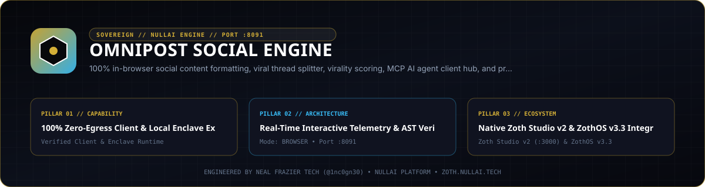

<p align="center">
  
</p>

# Omnipost Social Engine

**Zero-dependency Python 3.9+ multi-platform social copy formatter, sentence-aware thread splitter, copywriting hook generator, WCAG 2.2 alt-text accessibility auditor, UTM campaign URL builder/sanitizer, campaign exporter, and MCP server.**

- **Zoth Studio v2 Dossier**: [https://zoth.nullai.tech/tools/omnipost-social-engine](https://zoth.nullai.tech/tools/omnipost-social-engine)
- **Default Loopback Endpoint**: `http://127.0.0.1:8091`
- **Runtime Dependencies**: Zero external Python runtime packages (100% Python `stdlib`)
- **License**: MIT (100% free and open-source)

---

## Overview

`omnipost-social-engine` formats and validates posts across X/Twitter (`280` chars), Bluesky (`300` chars), Threads (`500` chars), Mastodon (`500` chars), LinkedIn (`3,000` chars), Facebook, and Instagram. It ships with a Google Material 3 dark loopback web workstation, deterministic Unicode typography styling (`bold`, `italic`, `bold_italic`, `monospace`, `script`, `double_struck`, `sans`, `underline`, `strikethrough`), sentence-preserving thread segmentation, engagement/readability scoring, ad-tracker parameter stripping (`fbclid`, `gclid`, `msclkid`, `twclid`), Buffer/Hootsuite/Typefully CSV export, and a 12-tool Model Context Protocol (MCP) server.

---

## Architecture

```text
src/omnipost_social_engine/
├── campaign_exporter.py          # Buffer, Hootsuite, Typefully CSV, JSON, and Markdown calendar exporters
├── hook_generator.py             # Deterministic hook templates across 9 copywriting frameworks
├── accessibility_synthesizer.py  # WCAG 2.2 image alt-text auditor and content-warning trigger scanner
├── utm_builder.py                # UTM parameter builder, click-ID URL sanitizer, and vanity HTML redirector
├── mcp_server.py                 # JSON-RPC 2.0 stdio MCP server exposing 12 social & UTM tools
├── ui_server.py                  # Loopback HTTP API + Google Material 3 Studio UI (127.0.0.1:8091)
└── cli.py                        # Unified CLI entrypoint (`omnipost`)
```

---

## Quickstart

```bash
git clone https://github.com/1nc0gn30/omnipost-social-engine.git
cd omnipost-social-engine
python3 -m pip install -e ".[dev]"

# Launch the loopback web workstation on http://127.0.0.1:8091
omnipost serve --host 127.0.0.1 --port 8091
```

Run directly from a source checkout without installing:

```bash
PYTHONPATH=src python3 -m omnipost_social_engine.cli serve --host 127.0.0.1 --port 8091
```

---

## CLI & MCP Usage

### CLI Subcommands

```bash
# View CLI help
omnipost --help

# Format and style a post for X/Twitter, LinkedIn, Bluesky, Threads, or Mastodon
omnipost format "Shipping deterministic Python tools." --platform bluesky --style bold --tags python,mcp --json

# Split long-form copy into numbered thread segments
omnipost split examples/developer-thread/draft.txt --platform twitter --limit 280 --numbering-format fraction --json

# Generate copywriting hooks across 9 frameworks
omnipost hooks "local-first developer tools" --niche tech --framework contrarian --count 5 --json

# Score readability, structure, and engagement readiness (0-100)
omnipost analyze "Here is why zero-dependency CLIs start faster." --platform linkedin --json

# Export a campaign schedule to Buffer/Hootsuite/Typefully CSV, JSON, or Markdown
omnipost export examples/launch-campaign/campaign.json --format csv --preset buffer

# Audit image alt-text accessibility and content-warning triggers
omnipost accessibility --alt "Terminal screenshot showing JSON output" --platform mastodon --json

# Build UTM URLs, strip tracking IDs, or generate multi-platform campaign links
omnipost utm --url "https://nullai.tech" --platform twitter --campaign q4_launch --json
omnipost utm --url "https://example.com/?fbclid=abc123&utm_source=x" --sanitize --json

# Print platform character limits and runtime diagnostics
omnipost platform --json

# Launch stdio MCP server or print client configs
omnipost mcp
omnipost mcp-config --client claude
```

### ZothOS v3.4.0 CLI Integration

On ZothOS v3.4.0 workstations, `omnipost` is available in `/usr/local/bin/omnipost`:

```bash
omnipost platform --json
omnipost web                 # Starts http://127.0.0.1:8091
omnipost desktop             # Launches the Electron workstation shell
```

### Model Context Protocol (MCP) Tools

```json
{
  "mcpServers": {
    "omnipost": {
      "command": "omnipost",
      "args": ["mcp"]
    }
  }
}
```

| MCP Tool | Description |
| :--- | :--- |
| `omni_format_post` | Format and style social copy with platform character checks and Unicode typography |
| `omni_split_thread` | Split long-form text into numbered, sentence-bounded thread segments |
| `omni_generate_hooks` | Generate opening hooks across 9 copywriting frameworks (`contrarian`, `curiosity_gap`, etc.) |
| `omni_analyze_engagement` | Score readability, sentiment, structure, and engagement readiness (`0-100`) |
| `omni_export_campaign` | Export multi-post campaigns to Buffer/Hootsuite/Typefully CSV, JSON, or Markdown |
| `omni_get_diagnostics` | Return platform character budgets, Unicode support status, and engine diagnostics |
| `omni_audit_accessibility` | Audit image alt-text against WCAG 2.2 checks and scan for content-warning triggers |
| `omni_build_utm_url` | Construct clean UTM campaign tracking URLs |
| `omni_sanitize_url` | Strip surveillance click IDs (`fbclid`, `gclid`, `msclkid`, `twclid`) while optionally keeping UTM tags |
| `omni_generate_campaign_links` | Generate synchronized UTM tracking URLs across multiple social platforms |
| `omni_tag_post_links` | Detect bare URLs inside post copy and tag them with platform UTM parameters |
| `omni_vanity_redirect` | Generate a standalone HTML redirect page with Open Graph and Twitter Card metadata |

---

## HTTP API Reference

When running on `http://127.0.0.1:8091`:

| Method | Endpoint | Description |
| :--- | :--- | :--- |
| `GET` | `/health`, `/api/health` | Service health status and Python runtime version |
| `GET` | `/api/diagnostics` | Platform character limits and engine diagnostics |
| `GET` | `/api/mcp/config` | Ready-to-paste MCP client configurations (`claude_desktop`, `cursor`, `cline`, `zed`) |
| `POST` | `/api/format` | Format and apply Unicode typography to post text |
| `POST` | `/api/split` | Split long text into numbered thread posts |
| `GET`/`POST` | `/api/hooks` | Generate hook candidates by topic, niche, and framework |
| `POST` | `/api/analyze` | Compute engagement readiness and readability metrics |
| `POST` | `/api/export` | Export campaign schedules (`json`, `csv`, `markdown`, `txt`) |
| `GET`/`POST` | `/api/accessibility` | Run WCAG 2.2 alt-text and content-warning checks |
| `POST` | `/api/utm/build`, `/api/utm/sanitize`, `/api/utm/campaign-links`, `/api/utm/tag-post`, `/api/utm/vanity` | UTM link construction, sanitization, and vanity redirect generation |

---

## Testing & Verification

```bash
# Run the pytest suite
python3 -m pytest -q

# Run CLI self-test
omnipost test

# Scan repository with gitleaks
gitleaks detect --source . --no-banner --redact
```

---

## Support

Omnipost Social Engine is 100% free and open-source software. Optional community support is available via [Buy Us a Coffee (Stripe)](https://buy.stripe.com/3cIfZg27PdKo2D64Ocfw40X).

## License

MIT License — Copyright (c) 2026 [1nc0gn30](https://1nc0gn30.si) (`@1nc0gn30`) & [NullAI](https://nullai.tech). See [LICENSE](LICENSE) for full text.
